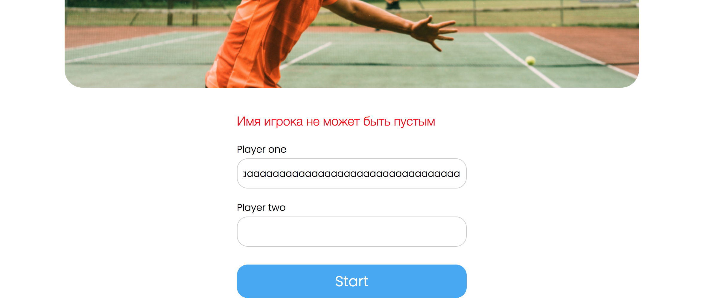
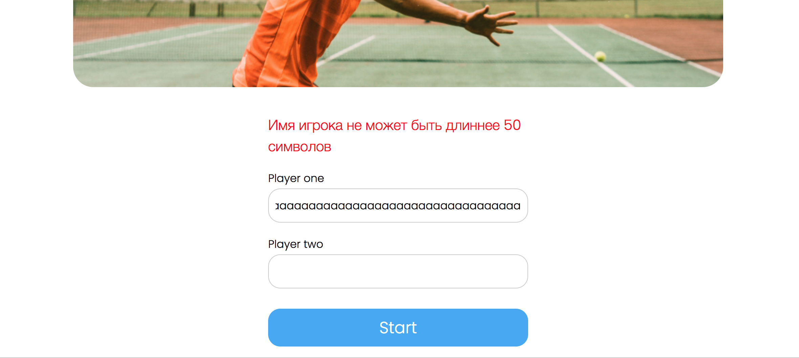
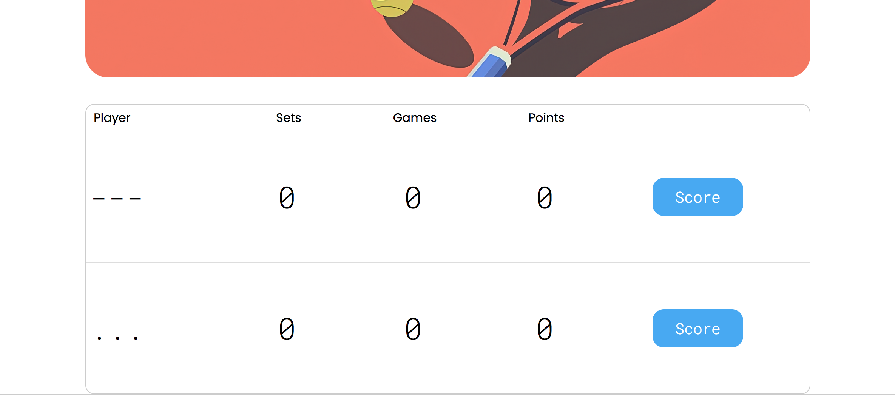
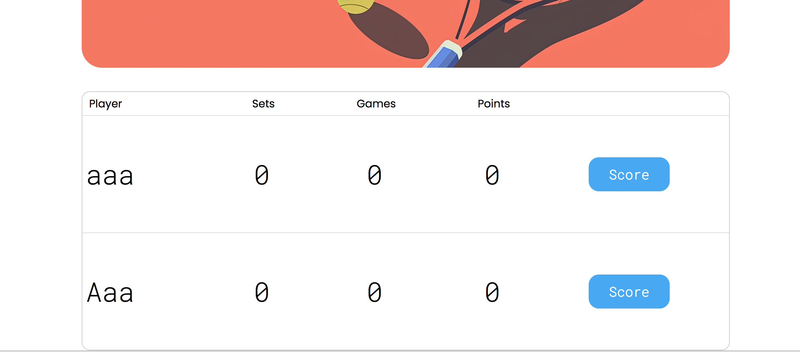
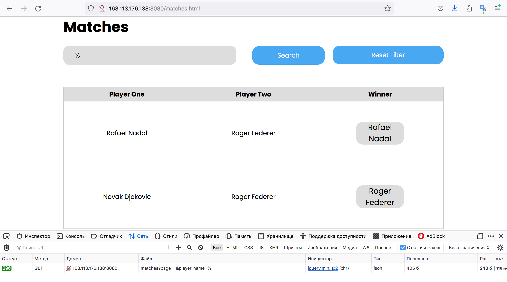
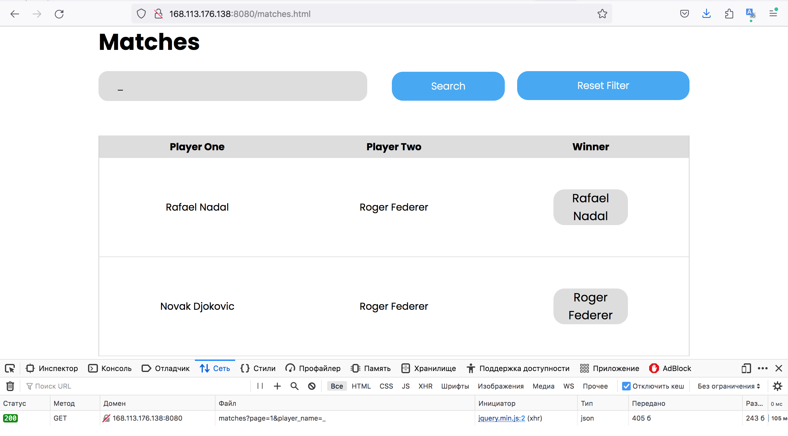

```text
Знаком ❗️ помечены критически важные замечания, а также места нарушения ТЗ.
```

## Функциональный обзор

- Сообщения об ошибке валидации имени сейчас отображаются по очереди:





Это ухудшает пользовательский опыт. Лучше сразу отображать все сообщения, чтобы пользователь мог исправить всё разом.

- Сейчас можно создать игроков с такими именами:



Раз в проекте есть валидация, стоит добавить проверку, что в имени есть буквы и ввести другие уместные ограничения.

- ❗️Можно создать игроков с одинаковыми именами, если написать их в разном регистре:



Имя игрока должно быть уникальным без учёта регистра.

- Последний сыгранный матч отображается последним в списке на странице завершённых матчей — чтобы посмотреть его результат в таблице надо листать до последней страницы. Лучше, чтобы последний завершённый отображался первым в списке (на первой странице).

- ❗️Если ввести в поисковую строку символы, которые являются специальными в SQL, то поиск будет выдавать полный список матчей.





Это свидетельствует об уязвимости этого поля к инъекции. Подобные уязвимости могут становиться векторами для атаки, поэтому стоит это исправить.
