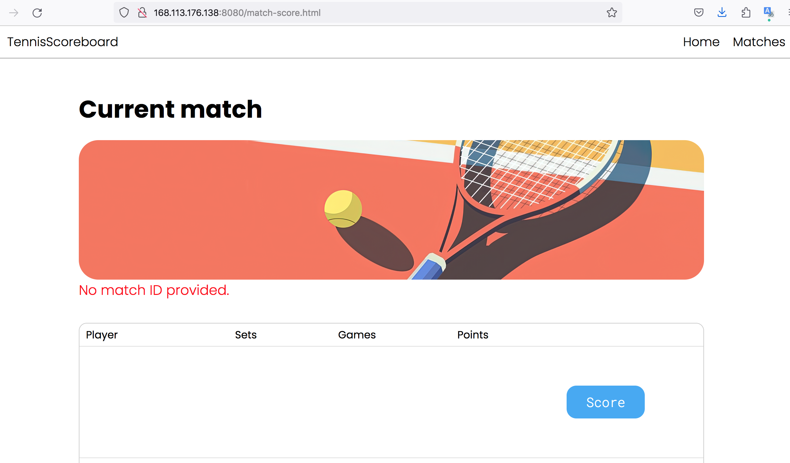

```text
Знаком ❗️ помечены критически важные замечания, а также места нарушения ТЗ.
```

## В целом по проекту

- ❗️По ТЗ в проекте не должен использоваться Spring Boot

- Неоднородность в именовании пакетов: одни названы во множественном числе, а другие — в единственном.

- Имена пакетов в java пишут в единственном числе. Когда смотришь на набор классов в пакете, кажется естественным использовать множественное число, обобщая то, что в нём находится, но если посмотреть на декларацию пакета в классе и сравнить варианты, например: `*.validation.limits.annotations.MaxLength` и `*.validation.limit.annotation.MaxLength`, то логика названия в единственном числе становится более понятной, так как это отображает полное имя одного (каждого) конкретного класса.

- Местами в классах не хватает форматирования. Перед `git commit` можно нажимать (`cmd + alt + l` в Idea на mac os). Это работает как для текущего класса, так и для всего пакета: если выделить пакет и нажать комбинацию клавиш, то исправление форматирования будет выполнено для всех классов в этом пакете.

- Сообщения в исключениях принято писать на английском языке. Если сообщения предназначены для пользователя, стоит использовать локализацию.

- ❗️Сейчас HTML страницы находятся в `src/main/resources/static` и любая страница доступна по прямому URL.

Например, сейчас можно открыть http://168.113.176.138/match-score.html и увидеть пустую страницу, предназначенную для текущего матча, котора должна быть доступна только при определённых условиях (когда матч создан).



Стоит найти способ это исправить.
