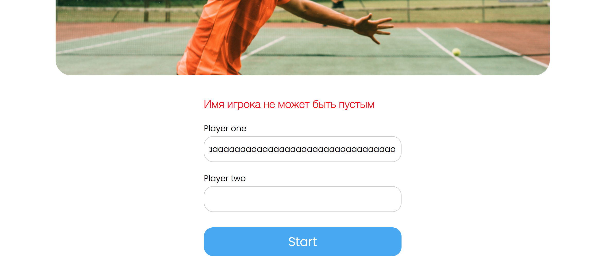
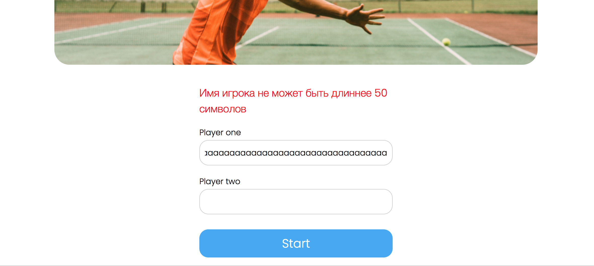
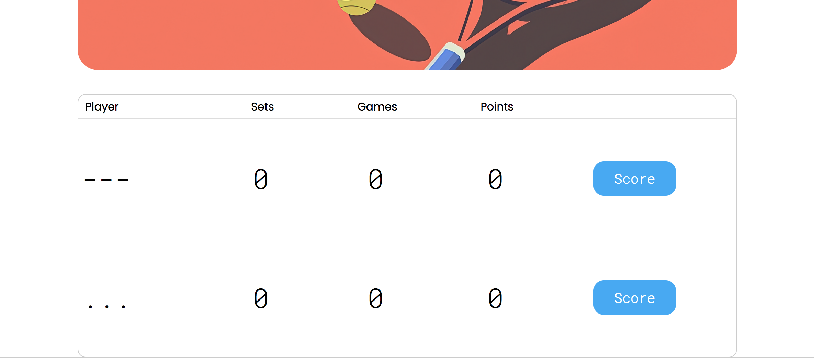
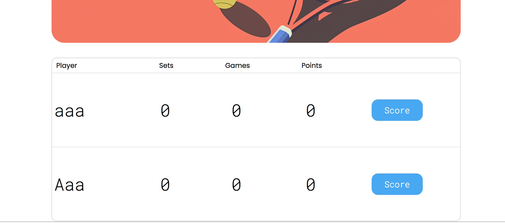
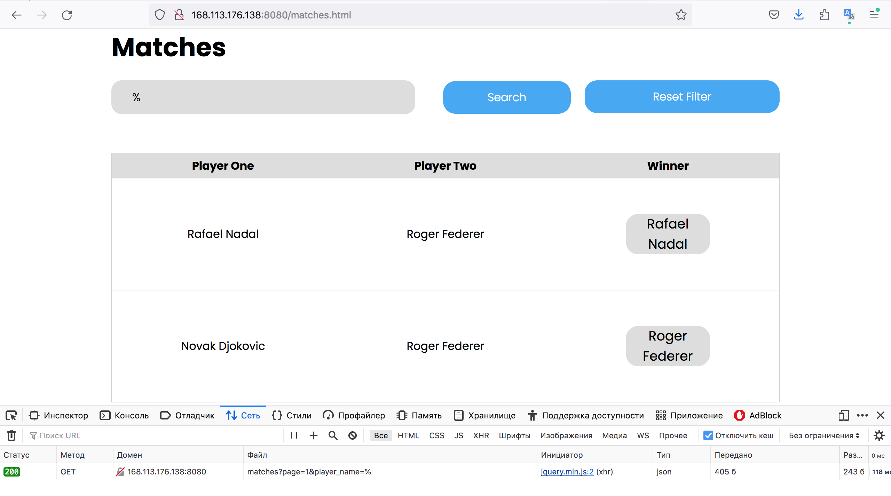
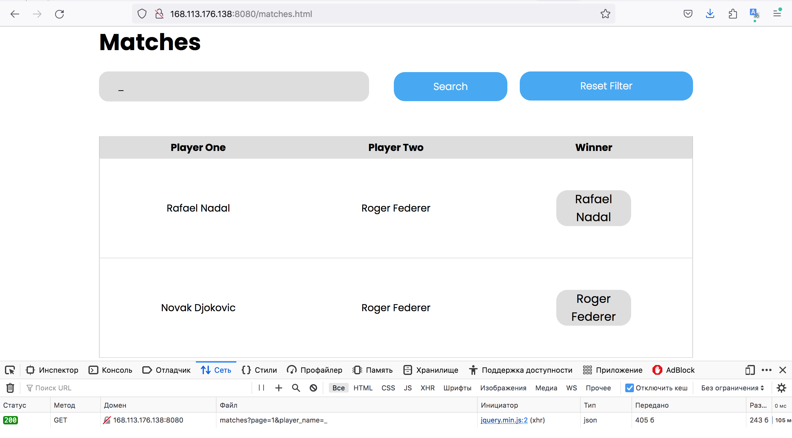
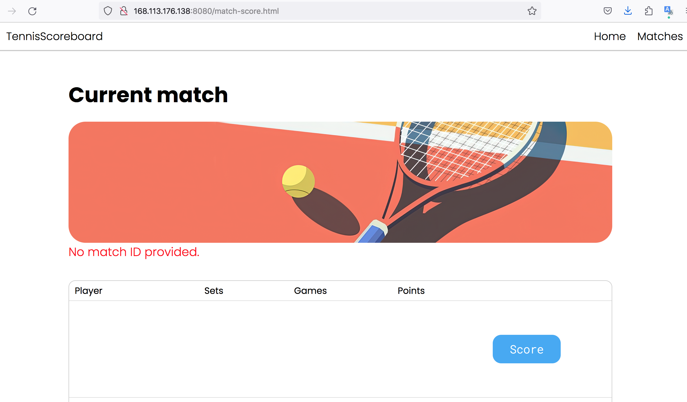

# Сводный отчёт по код-ревью проекта `tennis-scoreboard`

# Review на реализацию от [@Kirill_Lyam](https://github.com/KirillBadin/tennis-scoreboard) проекта [Табло теннисного матча](https://zhukovsd.github.io/java-backend-learning-course/projects/tennis-scoreboard/)

> Ревью выполнено в формате fork-а репозитория и добавления комментариев 'In-Situ' и обучающих заметок в формате markdown.

К классам и файлам конфигурации добавлены подробные комментарии. 

Там же есть ссылки на файлы, объясняющие некоторые особо значимые темы. 

Сами файлы с заметками находятся в одном пакете с классами, к которым относится тема заметки.

```
В `TODO`-комментариях️ описаны критически важные замечания, а также места нарушения ТЗ.
```

Список всех `TODO`-комментариев сгруппированных по пакетам и классам можно посмотреть в Idea через меню: `View` -> `Tool Windows` -> `TODO`

Читать стоит в таком порядке:

1. В файле `1-functional-overview.md` описан функциональный обзор приложения.

2. В файле `2-refactoring-roadmap.md` находится план работы над исправлениями.

- В файле `Common.md` описаны замечания, относящиеся ко всему проекту или нескольким его частям. (можно читать в любое время)

- В файле `Pluses.md` описаны наиболее значимые плюсы. (можно читать в любое время)

- В файле `Conclusion.md` находится заключение. (можно читать в любое время)

```text
Знаком ❗️ помечены критически важные замечания, а также места нарушения ТЗ.
```

## Функциональный обзор

- Сообщения об ошибке валидации имени сейчас отображаются по очереди:





Это ухудшает пользовательский опыт. Лучше сразу отображать все сообщения, чтобы пользователь мог исправить всё разом.

- Сейчас можно создать игроков с такими именами:



Раз в проекте есть валидация, стоит добавить проверку, что в имени есть буквы и ввести другие уместные ограничения.

- ❗️Можно создать игроков с одинаковыми именами, если написать их в разном регистре:



Имя игрока должно быть уникальным без учёта регистра.

- Последний сыгранный матч отображается последним в списке на странице завершённых матчей — чтобы посмотреть его результат в таблице надо листать до последней страницы. Лучше, чтобы последний завершённый отображался первым в списке (на первой странице).

- ❗️Если ввести в поисковую строку символы, которые являются специальными в SQL, то поиск будет выдавать полный список матчей.





Это свидетельствует об уязвимости этого поля к инъекции. Подобные уязвимости могут становиться векторами для атаки, поэтому стоит это исправить.

## Конфигурационные файлы

### pom.xml

Пустые блоки лучше либо заполнить реальными значениями, либо удалить.
```xml
	<!-- Пустые блоки лучше либо заполнить реальными значениями, либо удалить. -->
	<name/>
	<description/>
	<url/>
```
***

Если scope не указан, Maven по умолчанию считает scope compile, поэтому lombok попадёт в jar, хотя нужен только для компиляции. Лучше указать <scope>provided</scope> и исключить его в spring-boot-maven-plugin.
```xml
		<!-- Если scope не указан, Maven по умолчанию считает scope compile,
			поэтому lombok попадёт в jar, хотя нужен только для компиляции.
			Лучше указать <scope>provided</scope> и исключить его в spring-boot-maven-plugin. -->
		<dependency>
			<groupId>org.projectlombok</groupId>
			<artifactId>lombok</artifactId>
			<optional>true</optional>
		</dependency>
```
***

Все тесты в проекте используют классы из JUnit 5, поэтому достаточно только одной зависимости spring-boot-starter-test, на которую можно заменить все текущие стартеры.
```xml
		<!-- Все тесты в проекте используют классы из JUnit 5,
			поэтому достаточно только одной зависимости spring-boot-starter-test,
			на которую можно заменить все текущие стартеры -->
		<dependency>
			<groupId>org.springframework.boot</groupId>
			<artifactId>spring-boot-starter-data-jpa-test</artifactId>
			<scope>test</scope>
		</dependency>
		<dependency>
			<groupId>org.springframework.boot</groupId>
			<artifactId>spring-boot-starter-validation-test</artifactId>
			<scope>test</scope>
		</dependency>
		<dependency>
			<groupId>org.springframework.boot</groupId>
			<artifactId>spring-boot-starter-webmvc-test</artifactId>
			<scope>test</scope>
		</dependency>
```
***

Настройки annotationProcessorPaths можно объявить на уровне плагина, а не внутри каждого execution. Тогда они автоматически применятся ко всем execution плагина. Или можно не указывать совсем, если нет необходимости переопределять дефолтные.
```xml
			<plugin>
				<groupId>org.apache.maven.plugins</groupId>
				<artifactId>maven-compiler-plugin</artifactId>
				<!-- Настройки annotationProcessorPaths можно объявить на уровне плагина, а не внутри каждого execution.
					Тогда они автоматически применятся ко всем execution плагина.
					Или можно не указывать совсем, если нет необходимости переопределять дефолтные. -->
				<executions>
```
***

## io.github.kirillbadin.tennisscoreboard.controllers

### MatchController

В @PageableDefault нет явного указания направления сортировки. По умолчанию это сортировка по возрастанию (Sort.Direction.ASC). При таком подходе последний сыгранный матч окажется последним в списке и пользователю придётся листать до последней страницы, чтобы найти его в списке завершённых матчей. Лучше использовать сортировку по убыванию и явно указать direction = Sort.Direction.DESC. Это улучшит пользовательский опыт.
```java
    // В @PageableDefault нет явного указания направления сортировки.
        // По умолчанию это сортировка по возрастанию (Sort.Direction.ASC).
        // При таком подходе последний сыгранный матч окажется последним в списке и
        // пользователю придётся листать до последней страницы, чтобы найти его в списке завершённых матчей.
        // Лучше использовать сортировку по убыванию и явно указать direction = Sort.Direction.DESC.
        // Это улучшит пользовательский опыт.
    @GetMapping
    public ResponseEntity<MatchesPageDto> getMatches(
            @PageableDefault(size = DEFAULT_PAGE_SIZE, sort = "id") Pageable pageable,
            @RequestParam(name = "player_name", required = false) String playerName){
```
***

## io.github.kirillbadin.tennisscoreboard.entity

### sql-keywords.md

### Использование зарезервированных слов в качестве названий в БД

Использование зарезервированного слова (например, `USER`, `ORDER`, `GROUP`) в качестве названия таблицы в базе данных — это плохая практика, которая может привести к ряду проблем.

Вот основные из них:

### 1. Синтаксические ошибки

Это самая главная и частая проблема. SQL-парсер видит зарезервированное слово и ожидает определённой синтаксической конструкции, а не названия таблицы.

**Пример:**
При попытке получить все записи из таблицы с названием `ORDER`.
```sql
SELECT * FROM ORDER;
```
этот запрос, скорее всего, вызовет ошибку, потому что `ORDER` — это ключевое слово для `ORDER BY` (сортировка). Парсер будет ожидать после него `BY` и не поймёт, что `ORDER` — это название таблицы.

### 2. Необходимость экранирования (Quoting)

Чтобы обойти синтаксические ошибки, придётся постоянно заключать название таблицы в специальные кавычки, которые зависят от конкретной СУБД:

* **MySQL / MariaDB:** обратные кавычки (`` ` ``)
    ```sql
    SELECT * FROM `ORDER`;
    ```
* **PostgreSQL / Стандарт SQL:** двойные кавычки (`" "`)
    ```sql
    SELECT * FROM "ORDER";
    ```
* **SQL Server:** квадратные скобки (`[ ]`)
    ```sql
    SELECT * FROM [ORDER];
    ```

### 3. Снижение читаемости и усложнение кода

Из-за необходимости постоянного экранирования код становится менее читаемым. Разработчики могут легко забыть поставить кавычки, что приведёт к ошибкам, на поиск которых уйдёт время.

### 4. Проблемы с ORM и другими инструментами

Инструменты, которые автоматически генерируют SQL-запросы (например, Hibernate, JPA, SQLAlchemy и другие ORM), а также различные GUI-клиенты и утилиты для миграции, могут не справиться с такими названиями. Они могут не знать, что `ORDER` нужно экранировать, и будут генерировать нерабочий SQL-код. Это потребует дополнительной конфигурации или ручного вмешательства.

### 5. Потеря переносимости

Ключевые слова могут отличаться в разных СУБД. Слово, которое не зарезервировано в одной системе, может быть зарезервировано в другой. Если команда сменит СУБД, проект с такими названиями таблиц потребует значительной доработки.

---

**Лучшая практика:**

**Никогда не использовать зарезервированные слова для названий таблиц, столбцов и других объектов в БД.**

Всегда проверять список зарезервированных слов для основных СУБД. Чтобы избежать случайных совпадений, можно придерживаться соглашений об именовании, например:
* Использовать префиксы: `tbl_order`.
* Использовать множественное число (если слово во множественном числе не зарезервировано): `orders` (слово `orders` не зарезервировано).
* Добавлять суффиксы: `order_data`.

### Match

"matches" является зарезервированным словом в некоторых СУБД. Здесь проблем не будет, но лучше не выбирать такие названия. (см. файл "sql-keywords.md" в этом же пакете)
```java
@Table(name = "matches", check = {
        @CheckConstraint(name = "chk_different_players", constraint = "first_player_id <> second_player_id"),
        @CheckConstraint(name = "chk_winner_one_of_players", constraint = "winner_id = first_player_id OR winner_id = second_player_id")
}) // "matches" является зарезервированным словом в некоторых СУБД.
    // Здесь проблем не будет, но лучше не выбирать такие названия. (см. файл "sql-keywords.md" в этом же пакете)
```
***

## io.github.kirillbadin.tennisscoreboard.exceptions

### GlobalExceptionHandler

Лучше возвращать все ошибки, а не только первую, чтобы пользователь сразу мог исправить все недочёты.
```java
        String message = e.getBindingResult().getFieldErrors().stream()
                .findFirst() // Лучше возвращать все ошибки, а не только первую, чтобы пользователь сразу мог исправить все недочёты
```
***

Возвращает только текст сообщения без имени поля — лучше что-то вроде field + ": " + message.
```java
                .map(FieldError::getDefaultMessage) // Возвращает только текст сообщения без имени поля — лучше что-то вроде field + ": " + message
```
***

### PlayerNotInMatchException

Сейчас PlayerNotInMatchException уходит в 500, хотя это клиентская ошибка (400).
```java
    // TODO: Сейчас PlayerNotInMatchException уходит в 500, хотя это клиентская ошибка (400).

    public PlayerNotInMatchException(String message) {
```
***

## io.github.kirillbadin.tennisscoreboard.live

### live.md

## live

- В пакете хранятся классы доменных моделей, поэтому название `model` для него будет более подходящим.

### GamePoint

В идеале класс, относящийся к слою доменной модели, не должен знать о том, как он будет отображаться во View. Поэтому этот enum не должен содержать поле с названием display. На мой взгляд, конкретно в этом проекте допустим компромисс в виде хранения строкового значения GamePoint, но только не с семантикой "значение для отображения", а со смыслом "строковое значение по умолчанию". Поэтому полю больше подошло бы название stringValue или defaultStringValue.
```java
    // В идеале класс, относящийся к слою доменной модели, не должен знать о том, как он будет отображаться во View.
        // Поэтому этот enum не должен содержать поле с названием display.
        // На мой взгляд, конкретно в этом проекте допустим компромисс в виде хранения строкового значения GamePoint,
        // но только не с семантикой "значение для отображения", а со смыслом "строковое значение по умолчанию".
        // Поэтому полю больше подошло бы название stringValue или defaultStringValue.
    private final String display;
```
***

Можно использовать lombok.Getter.
```java
    // Можно использовать lombok.Getter
    public String getDisplay() {
```
***

### GameScore

Нет метода isFinished(). Можно добавить его и использовать, как в соседних классах.
```java
    // Нет метода isFinished(). Можно добавить его и использовать, как в соседних классах.

    private GamePoint firstSidePoints = GamePoint.LOVE;
```
***

Можно просто winner.
```java
    private PlayerSide gameWinner; // Можно просто winner
```
***

Можно вынести эту проверку во вспомогательный метод. Тогда код в addPoint будет читаться более декларативно и будет сосредоточен только на самом счёте.
```java
        // Можно вынести эту проверку во вспомогательный метод.
            // Тогда код в addPoint будет читаться более декларативно и будет сосредоточен только на самом счёте.
        if(gameWinner != null){
            throw new IllegalStateException("Game already finished");
        }
```
***

Тело блоков if-else всегда следует оборачивать в {}. Это: - Предотвращает критические баги при поддержке кода — если кто-то добавит перед существующим кодом новую строку (например логирование) - Позволяет избежать ловушки "Блуждающего else" (Dangling else) - Повышает скорость чтения кода — фигурные скобки служат понятными визуальными якорями, разграничивающими блоки кода.
```java
        // Тело блоков if-else всегда следует оборачивать в {}. Это:
            // - Предотвращает критические баги при поддержке кода —
                // если кто-то добавит перед существующим кодом новую строку (например логирование)
            // - Позволяет избежать ловушки "Блуждающего else" (Dangling else)
            // - Повышает скорость чтения кода —
                // фигурные скобки служат понятными визуальными якорями, разграничивающими блоки кода
        if (side == PlayerSide.FIRST) firstSidePoints = points;
        else secondSidePoints = points;
```
***

### LiveMatch

Можно добавить в этот класс метод isFinished, чтобы при необходимости вызывать его, а не liveMatch.getWinnerSide().isEmpty().
```java
    // Можно добавить в этот класс метод isFinished, чтобы при необходимости вызывать его,
        // а не liveMatch.getWinnerSide().isEmpty().

    @Getter
```
***

Класс текущего матча в этом проекте может не хранить в себе ID. Но если ID в нём есть, то можно получать его извне (по аналогии с JPA Entity), а не генерировать в самом классе модели.
```java
        // Класс текущего матча в этом проекте может не хранить в себе ID.
            // Но если ID в нём есть, то можно получать его извне (по аналогии с JPA Entity),
            // а не генерировать в самом классе модели.
        this.uuid = UUID.randomUUID();
```
***

Нет проверки на то, что матч не завершён. Попытка начислить очко в уже завершённом матче — это не нормальная ситуация и должна приводить к исключению. Проверка есть ниже по стеку, но каждый класс сам должен защищать свои инварианты.
```java
        // TODO: Нет проверки на то, что матч не завершён.
            // Попытка начислить очко в уже завершённом матче — это не нормальная ситуация и должна приводить к исключению.
            // Проверка есть ниже по стеку, но каждый класс сам должен защищать свои инварианты.

        // Можно ввести вспомогательный метод и избавиться от блоков if. В таком духе:
```
***

Можно ввести вспомогательный метод и избавиться от блоков if. В таком духе: PlayerSide side = getSideFor(name); matchScore.addPoint(side);
```java
        /*
        PlayerSide side = getSideFor(name);
        matchScore.addPoint(side);
         */
        if (firstPlayerName.equals(name)) {
            matchScore.addPoint(PlayerSide.FIRST);
            return;
        }
        if (secondPlayerName.equals(name)) {
            matchScore.addPoint(PlayerSide.SECOND);
            return;
        }
```
***

Валидацию имени игрока лучше проводить в самом начале метода. Это лучше читается и соответствует принципу Fail Fast по стилю написания.
```java
        // Валидацию имени игрока лучше проводить в самом начале метода.
            // Это лучше читается и соответствует принципу Fail Fast по стилю написания.
        throw new PlayerNotInMatchException("Игрок '" + name + "' не найден в матче");
```
***

### LiveMatchStorage

Класс не относится к доменным моделям, поэтому лучше перенести его в более подходящий пакет.
```java
    // Класс не относится к доменным моделям, поэтому лучше перенести его в более подходящий пакет.

    private final Map<UUID, LiveMatch> storage = new ConcurrentHashMap<>();
```
***

Хранилище может само создавать ID для матча (по аналогии с БД) и возвращать его из этого метода.
```java
    // Хранилище может само создавать ID для матча (по аналогии с БД) и возвращать его из этого метода.
    public void save(LiveMatch liveMatch) {
```
***

### MatchScore

Можно вынести эту проверку во вспомогательный метод. Тогда код в addPoint будет читаться более декларативно и будет сосредоточен только на самом счёте.
```java
        // Можно вынести эту проверку во вспомогательный метод.
            // Тогда код в addPoint будет читаться более декларативно и будет сосредоточен только на самом счёте.
        if (isFinished()) {
            throw new IllegalStateException("Match already finished");
        }
```
***

Условие из этого if можно вынести во вспомогательный метод (например isWon(PlayerSide.FIRST)). Это ещё улучшит читаемость и позволит его переиспользовать во втором if.
```java
        // Условие из этого if можно вынести во вспомогательный метод (например isWon(PlayerSide.FIRST)).
            // Это ещё улучшит читаемость и позволит его переиспользовать во втором if.
        if (getSets(PlayerSide.FIRST) >= SETS_TO_WIN) {
```
***

### SetScore

Вместо хранения отдельных полей для обычного гейма и тай-брейка, лучше иметь коллекцию геймов/тай-брейков и наполнять её по ходу игры. Это больше соответствовало бы реальному теннисному матчу. А также позволило бы не хранить счёт в отдельных переменных, а вычислять его на лету.
```java
    // Вместо хранения отдельных полей для обычного гейма и тай-брейка,
        // лучше иметь коллекцию геймов/тай-брейков и наполнять её по ходу игры.
        // Это больше соответствовало бы реальному теннисному матчу.
        // А также позволило бы не хранить счёт в отдельных переменных, а вычислять его на лету.

    // Функциональной разницы нет, но наиболее распространённым порядком ключевых слов является: private static final
```
***

Функциональной разницы нет, но наиболее распространённым порядком ключевых слов является: private static final.
```java
    private final static int WINNING_SET_GAMES = 6;
```
***

Точнее firstGames.
```java
    private int firstGame; // Точнее firstGames
```
***

Точнее secondGames.
```java
    private int secondGame; // Точнее secondGames
```
***

Можно вынести эту проверку во вспомогательный метод. Тогда код в addPoint будет читаться более декларативно и будет сосредоточен только на самом счёте.
```java
        // Можно вынести эту проверку во вспомогательный метод.
            // Тогда код в addPoint будет читаться более декларативно и будет сосредоточен только на самом счёте.
        if (isFinished()) {
            throw new IllegalStateException("Set already finished");
        }
```
***

Можно создать для гейма и тай-брейка общий интерфейс и хранить их объекты в поле по этому интерфейсу. Это будет соответствовать принципу полиморфизма, а также избавить от дублирования и упростит логику этого метода.
```java
        // Можно создать для гейма и тай-брейка общий интерфейс и хранить их объекты в поле по этому интерфейсу.
            // Это будет соответствовать принципу полиморфизма,
            // а также избавить от дублирования и упростит логику этого метода.
        if (tieBreakScore != null) {
            tieBreakScore.addPoint(side);
            tieBreakScore.getWinner().ifPresent(this::handleGameWin);
        } else {
            gameScore.addPoint(side);
            gameScore.getWinner().ifPresent(this::handleGameWin);
        }
```
***

В других методах аргумент PlayerSide называется side, а здесь playerSide. Для единообразия, лучше везде использовать одинаковые имена. Метод выполняет два разных действия: увеличивает счёт и создаёт объект нового гейма. Это нарушение Принципа единой ответственности (SRP) на уровне метода. Стоит разделить эти две задачи на разные более специализированные методы. Название handle* малоинформативное и часто свидетельствует о том, что метод делает слишком многое, чтобы ясно выделить его ответственность и отразить её в названии.
```java
    // В других методах аргумент PlayerSide называется side, а здесь playerSide.
        // Для единообразия, лучше везде использовать одинаковые имена.
    // Метод выполняет два разных действия: увеличивает счёт и создаёт объект нового гейма.
        // Это нарушение Принципа единой ответственности (SRP) на уровне метода.
        // Стоит разделить эти две задачи на разные более специализированные методы.
    // Название handle* малоинформативное и часто свидетельствует о том, что метод делает слишком многое,
        // чтобы ясно выделить его ответственность и отразить её в названии.
    private void handleGameWin(PlayerSide winnerSide) {
```
***

После завершения сета метод всегда создаёт объект GameScore, который никогда не используется.
```java
            // TODO: После завершения сета метод всегда создаёт объект GameScore, который никогда не используется.
            gameScore = new GameScore();
```
***

Все магические числа лучше выносить в `private static final` константы с понятными именами. Именованная константа делает код более семантически понятным. Составные условия из if лучше выносить во вспомогательный метод с понятным названием. Сложные логические выражения требуют усилий для понимания, ухудшают читаемость кода и увеличивают вероятность ошибки при их написании или изменении. Лучше выносить такие условия в отдельный private-метод с понятным названием, которое описывает бизнес-правило.
```java
        // Все магические числа лучше выносить в `private static final` константы с понятными именами.
            // Именованная константа делает код более семантически понятным.
        // Составные условия из if лучше выносить во вспомогательный метод с понятным названием
            // Сложные логические выражения требуют усилий для понимания, ухудшают читаемость кода и
            // увеличивают вероятность ошибки при их написании или изменении.
            // Лучше выносить такие условия в отдельный private-метод с понятным названием,
            // которое описывает бизнес-правило.
        if (firstGame >= WINNING_SET_GAMES && firstGame - secondGame >= 2) {
```
***

### TieBreakScore

Нет метода isFinished(). Можно добавить его и использовать, как в соседних классах.
```java
    // Нет метода isFinished(). Можно добавить его и использовать, как в соседних классах.

    private static final int WINNING_POINTS = 7;
```
***

В других классах в методе addPoint аргумент называется side, а здесь playerSide. Для единообразия, лучше везде использовать одинаковые имена.
```java
    // В других классах в методе addPoint аргумент называется side, а здесь playerSide.
        // Для единообразия, лучше везде использовать одинаковые имена.
    public void addPoint(PlayerSide playerSide) {
```
***

Можно вынести эту проверку во вспомогательный метод. Тогда код в addPoint будет читаться более декларативно и будет сосредоточен только на самом счёте.
```java
        // Можно вынести эту проверку во вспомогательный метод.
            // Тогда код в addPoint будет читаться более декларативно и будет сосредоточен только на самом счёте.
        if (getWinner().isPresent()) {
            throw new IllegalStateException("Tiebreak already finished");
        }
```
***

Составные условия из if лучше выносить во вспомогательный метод с понятным названием. Сложные логические выражения требуют усилий для понимания, ухудшают читаемость кода и увеличивают вероятность ошибки при их написании или изменении. Лучше выносить такие условия в отдельный private-метод с понятным названием, которое описывает бизнес-правило.
```java
        // Составные условия из if лучше выносить во вспомогательный метод с понятным названием
            // Сложные логические выражения требуют усилий для понимания, ухудшают читаемость кода и
            // увеличивают вероятность ошибки при их написании или изменении.
            // Лучше выносить такие условия в отдельный private-метод с понятным названием,
            // которое описывает бизнес-правило.
        if (firstSidePoints >= WINNING_POINTS && firstSidePoints - secondSidePoints >= MINIMUM_DIFFERENCE) {
```
***

## io.github.kirillbadin.tennisscoreboard.repositories

### MatchRepository

Лучше выносить тексты JPQL запросов в константы и давать им понятные имена.
```java
    // Лучше выносить тексты JPQL запросов в константы и давать им понятные имена.

    // Для визуального разделения запросов на строки лучше использовать текстовые блоки, а не конкатенацию строк.
```
***

Для визуального разделения запросов на строки лучше использовать текстовые блоки, а не конкатенацию строк.
```java
    @Query("SELECT m FROM Match m " +
            "WHERE LOWER(m.firstPlayer.name) LIKE LOWER(CONCAT('%', :playerName, '%')) " +
            "OR LOWER(m.secondPlayer.name) LIKE LOWER(CONCAT('%', :playerName, '%')) ")
```
***

Wild card Injection в параметре playerName. В SQL в шаблоне LIKE: '%' соответствует любой последовательности символов (включая пустую). '_' соответствует ровно одному любому символу. Сейчас, если пользователь например в качестве параметра playerName передаст '%' или '_', то приложение вернёт ему список вообще всех матчей. В текущем проекте это безобидное поведение, но уязвимость Wildcard Injection может становиться вектором для атаки. Стоит найти решение, как это исправить.
```java
    // TODO: Wildcard Injection в параметре playerName.
        // В SQL в шаблоне LIKE:
        // '%' соответствует любой последовательности символов (включая пустую).
        // '_' соответствует ровно одному любому символу.
        // Сейчас, если пользователь например в качестве параметра playerName передаст '%' или '_',
        // то приложение вернёт ему список вообще всех матчей.
        // В текущем проекте это безобидное поведение,
        // но уязвимость Wildcard Injection может становиться вектором для атаки.
        // Стоит найти решение, как это исправить.
    @EntityGraph(attributePaths = {"firstPlayer", "secondPlayer", "winner"})
    @Query("SELECT m FROM Match m " +
```
***

## io.github.kirillbadin.tennisscoreboard.services

### LiveMatchService

Класс совмещает несколько разных ответственностей: работает с текущими матчами, занимается преобразованием в DTO. Это нарушает принцип единой ответственности (SRP). Стоит вынести логику преобразования в отдельный компонент — маппер.
```java
    // TODO: Класс совмещает несколько разных ответственностей:
        // - работает с текущими матчами
        // - занимается преобразованием в DTO
        //
        // Это нарушает принцип единой ответственности (SRP).
        // Стоит вынести логику преобразования в отдельный компонент — маппер.

    private final LiveMatchStorage liveMatchStorage;
```
***

Race condition при обработке выигранного очка. Если пользователь дважды быстро нажмёт кнопку выигрыша очка, браузер отправит два POST-запроса почти одновременно. Оба потока успеют получить ссылку на один и тот же объект LiveMatch до того, как первый завершит матч и удалит его из storage. Первый поток в synchronized добавит решающее очко и сохранит матч в БД. Второй поток с уже устаревшей ссылкой вызовет addPoint() на уже завершённом матче, получит IllegalStateException из MatchScore.addPoint (дубля в БД не будет, так как до save дело не дойдёт), и пользователь увидит 500 на двойной клик. Стоит найти решение, как это исправить.
```java
    // TODO: Race condition при обработке выигранного очка.
        // Если пользователь дважды быстро нажмёт кнопку выигрыша очка, браузер отправит два POST-запроса почти одновременно.
        // Оба потока успеют получить ссылку на один и тот же объект LiveMatch до того, как первый завершит матч и удалит его из storage.
        // Первый поток в synchronized добавит решающее очко и сохранит матч в БД.
        // Второй поток с уже устаревшей ссылкой вызовет addPoint() на уже завершённом матче,
        // получит IllegalStateException из MatchScore.addPoint
        // (дубля в БД не будет, так как до save дело не дойдёт), и пользователь увидит 500 на двойной клик.
        // Стоит найти решение, как это исправить.
    public MatchStateDto addPoint(UUID uuid, PointRequestDto pointRequestDto) {
```
***

### MatchService

Класс совмещает несколько разных ответственностей: работает с завершёнными матчами, занимается преобразованием в DTO. Это нарушает принцип единой ответственности (SRP). Стоит вынести логику преобразования в отдельный компонент — маппер.
```java
    // TODO: Класс совмещает несколько разных ответственностей:
        // - работает с завершёнными матчами
        // - занимается преобразованием в DTO
        //
        // Это нарушает принцип единой ответственности (SRP).
        // Стоит вынести логику преобразования в отдельный компонент — маппер.

    private final MatchRepository matchRepository;
```
***

Логику преобразования Entity -> DTO лучше вынести во вспомогательный метод. Ещё лучше в отдельный компонент — маппер.
```java
        // Логику преобразования Entity -> DTO лучше вынести во вспомогательный метод.
            // Ещё лучше в отдельный компонент — маппер.
        Page<MatchDto> dtoPage = allMatches.map(match -> new MatchDto(
```
***

По ТЗ и логике текущей реализации, игроки сохраняются в БД при создании матча, а не после его завершения. Поэтому если в этом методе игрока по какой-то причине не существует в БД — это неожиданная ситуация и должна приводить к исключению. Код с промежуточными переменными с понятными именами читается лучше, чем вызовы методов, передаваемые в аргументы другим методам.
```java
        // TODO: По ТЗ и логике текущей реализации, игроки сохраняются в БД при создании матча, а не после его завершения.
            // Поэтому если в этом методе игрока по какой-то причине не существует в БД —
            // это неожиданная ситуация и должна приводить к исключению.
        // Код с промежуточными переменными с понятными именами читается лучше,
            // чем вызовы методов, передаваемые в аргументы другим методам.
        Player firstPlayer = playerService.getOrCreatePlayer(liveMatch.getPlayerName(PlayerSide.FIRST));
```
***

```text
Знаком ❗️ помечены критически важные замечания, а также места нарушения ТЗ.
```

## В целом по проекту

- ❗️По ТЗ в проекте не должен использоваться Spring Boot

- Неоднородность в именовании пакетов: одни названы во множественном числе, а другие — в единственном.

- Имена пакетов в java пишут в единственном числе. Когда смотришь на набор классов в пакете, кажется естественным использовать множественное число, обобщая то, что в нём находится, но если посмотреть на декларацию пакета в классе и сравнить варианты, например: `*.validation.limits.annotations.MaxLength` и `*.validation.limit.annotation.MaxLength`, то логика названия в единственном числе становится более понятной, так как это отображает полное имя одного (каждого) конкретного класса.

- Местами в классах не хватает форматирования. Перед `git commit` можно нажимать (`cmd + alt + l` в Idea на mac os). Это работает как для текущего класса, так и для всего пакета: если выделить пакет и нажать комбинацию клавиш, то исправление форматирования будет выполнено для всех классов в этом пакете.

- Сообщения в исключениях принято писать на английском языке. Если сообщения предназначены для пользователя, стоит использовать локализацию.

- ❗️Сейчас HTML страницы находятся в `src/main/resources/static` и любая страница доступна по прямому URL.

Например, сейчас можно открыть http://168.113.176.138/match-score.html и увидеть пустую страницу, предназначенную для текущего матча, котора должна быть доступна только при определённых условиях (когда матч создан).



Стоит найти способ это исправить.

## Плюсы

- Имена классов, методов и переменных понятны и отражают их назначение
- Логичное разделение классов проекта по пакетам
- Есть разделение на слои (Controller -> Service -> Repository)
- Используются транзакции
- Управление транзакциями не находится в слое репозиториев
- Нет проблемы N+1 в запросах к БД
- Реализованы специализированные классы исключений
- Используется ConcurrentHashMap для хранения текущих матчей
- Проведена декомпозиция предметной области
- Корректная реализация основной бизнес-логики
- Логика обработки счёта не находится в сервисном слое
- Есть тесты для бизнес-логики
- Реализована валидация
- Есть централизованная обработка исключений
- Используются DTO
- Работает фильтрация матчей по имени игрока
- Учётные данные для БД не хранятся в github
- Успешный деплой приложения
- Есть docker-compose файл

## Заключение

Очень уверенная реализация проекта с хорошей декомпозицией домена.

При разработке учтены все типовые для этого проекта ошибки.

Рефакторинг по описанным замечаниям должен пройти легко. Доработка приложения позволит чуть глубже погрузиться в уже известные темы и дополнительно укрепит профессионализм разработчика.
